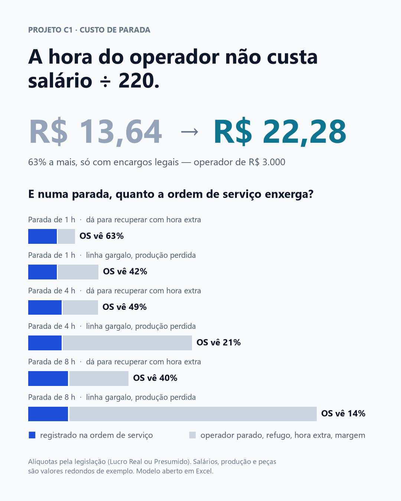

# Quanto custa uma hora de linha parada — e quanto disso a ordem de serviço enxerga

**A hora de um operador de R$ 3.000 não custa R$ 13,64 (salário ÷ 220). Com os
encargos legais, custa R$ 22,28 — 63% a mais. E numa parada de linha, a ordem de
serviço registra de 63% a só 14% do custo real, conforme a duração e se a produção
perdida pode ser recuperada.**



## A pergunta

Quando uma linha para, quanto isso custa de verdade?

A resposta que costuma aparecer é a da ordem de serviço: horas do técnico e peças
trocadas. Mas a parada também deixa operador recebendo sem produzir, refugo no
reinício, hora extra para repor a produção — ou, se a linha é gargalo, margem que não
volta mais. Nada disso aparece em relatório de manutenção. E sem esse número, a
decisão de investir em preventiva, peça reserva ou redundância é tomada no escuro.

## Os dados

Não há dataset: é um **modelo de cálculo**, em [`modelo.xlsx`](modelo.xlsx). Duas
camadas de premissas, separadas na planilha:

- **Regras legais, com fonte citada em cada linha:** INSS patronal 20% (Lei
  8.212/1991, art. 22, I), RAT 3% de exemplo (art. 22, II — varia de 1% a 3%, vezes
  o FAP), terceiros 5,8%, FGTS 8% (Lei 8.036/1990), provisão de 13º e de férias + 1/3,
  divisor de 220 horas e adicional mínimo de hora extra de 50% (CF, art. 7º, XVI).
- **Premissas da operação, com valores redondos de EXEMPLO:** 4 operadores de
  R$ 3.000, 2 técnicos de R$ 4.000, 200 peças por hora, margem de R$ 5 por peça,
  50 peças refugadas no reinício a R$ 8 de material, R$ 1.000 em peças no reparo.

Nenhum desses valores de exemplo vem de empresa real.

## O que eu fiz

Uma planilha com fórmulas vivas e nomes legíveis (`=SalOp*FatorEncargos/HorasMes`),
para qualquer gestor auditar a conta. Ela separa o custo em duas partes — o que a
ordem de serviço costuma registrar e o que não aparece em lugar nenhum — e trata a
decisão que mais muda o resultado: **a produção perdida pode ser recuperada?** Se
pode, o custo é hora extra. Se a linha é gargalo e está vendida, é margem perdida. O
modelo nunca soma as duas coisas para a mesma peça.

Os resultados abaixo foram calculados pelo próprio Excel e exportados para
[`resultados.json`](resultados.json).

| Parada | Situação | Custo total | Por hora | A OS registra |
|---|---|---|---|---|
| 1 h | dá para recuperar | R$ 1.682 | R$ 1.682 | **63%** |
| 1 h | linha gargalo | R$ 2.549 | R$ 2.549 | **42%** |
| 4 h | dá para recuperar | R$ 2.529 | R$ 632 | **49%** |
| 4 h | linha gargalo | R$ 5.994 | R$ 1.499 | **21%** |
| 8 h | dá para recuperar | R$ 3.658 | R$ 457 | **40%** |
| 8 h | linha gargalo | R$ 10.588 | R$ 1.324 | **14%** |

## O que isso significa

**Para quem calcula custo de mão de obra:** a hora real custa cerca de 60% a mais que
salário ÷ 220. Esse percentual não depende do salário nem das premissas de exemplo —
sai só da legislação, e vale para qualquer empresa do mesmo regime tributário.

**Para quem decide investimento em manutenção:** a ordem de serviço é o pior lugar
para medir o custo de uma parada. Quanto mais longa a parada e mais vendida a linha,
menos ela enxerga — no pior cenário do exemplo, a OS registra R$ 1.475 de um custo
real de R$ 10.588. Uma peça reserva ou uma preventiva que parece cara diante da OS
pode ser barata diante do custo inteiro.

**A primeira hora é a mais cara.** Quando dá para recuperar a produção, o custo por
hora cai de R$ 1.682 (1 h) para R$ 457 (8 h), porque peças e refugo são por parada,
não por hora. Paradas curtas e frequentes custam mais, por hora, do que parecem.

**Linha gargalo muda tudo.** Na mesma parada de 8 h, o custo passa de R$ 3.658 para
R$ 10.588 só porque a produção perdida não volta. Saber quais linhas são gargalo vem
antes de qualquer cálculo de custo de parada.

## Limitações

- **Os valores da operação são exemplo.** A proporção que a OS registra depende
  diretamente deles — com peças mais caras, a OS enxerga mais; com margem maior, menos.
  O padrão (a OS enxerga menos em paradas longas e linhas gargalo) se mantém; os
  percentuais exatos não se transferem para outra operação.
- **Regime tributário.** As alíquotas valem para Lucro Real e Presumido. No Simples
  Nacional o INSS patronal é diferente, e o fator de encargos cai.
- **RAT de exemplo.** 3% é o teto sem FAP. Com RAT de 1%, o acréscimo sobre a hora cai
  de 63% para 61%; com FAP acima de 1, sobe.
- **O custo por hora está subestimado.** Não entram benefícios (vale-transporte,
  refeição, plano de saúde), feriados, absenteísmo nem multa rescisória — todos
  aumentam o custo real da hora.
- **Hora extra aproximada.** Usa o mesmo fator de encargos da hora normal e assume que
  a recuperação acontece no mesmo ritmo de produção.
- **Fica de fora:** multa contratual por atraso, energia gasta no reinício e o efeito
  da parada em outras linhas que dependem desta.

## Como usar

Abra [`modelo.xlsx`](modelo.xlsx) no Excel, no LibreOffice ou no Google Planilhas:

1. Aba **Premissas** — troque as células azuis pelos valores da sua operação.
2. Aba **Cálculo** — o custo da parada, com duração e percentual recuperável definidos
   nas premissas.
3. Aba **Cenários** — a comparação de 1, 4 e 8 horas, com e sem recuperação.

Para atualizar os números exportados e a capa depois de mudar a planilha: salve o
arquivo (o Excel, o LibreOffice e o Google Planilhas guardam o resultado de cada
fórmula junto com ela) e rode:

```bash
pip install openpyxl matplotlib
python exportar_resultados.py   # lê os valores salvos na planilha → resultados.json
python gerar_capa.py            # desenha capa.png a partir de resultados.json
```

---

Ramon Goveia · [linkedin.com/in/ramon-goveia-92266443](https://www.linkedin.com/in/ramon-goveia-92266443) · projeto C1 de 16 do portfólio
